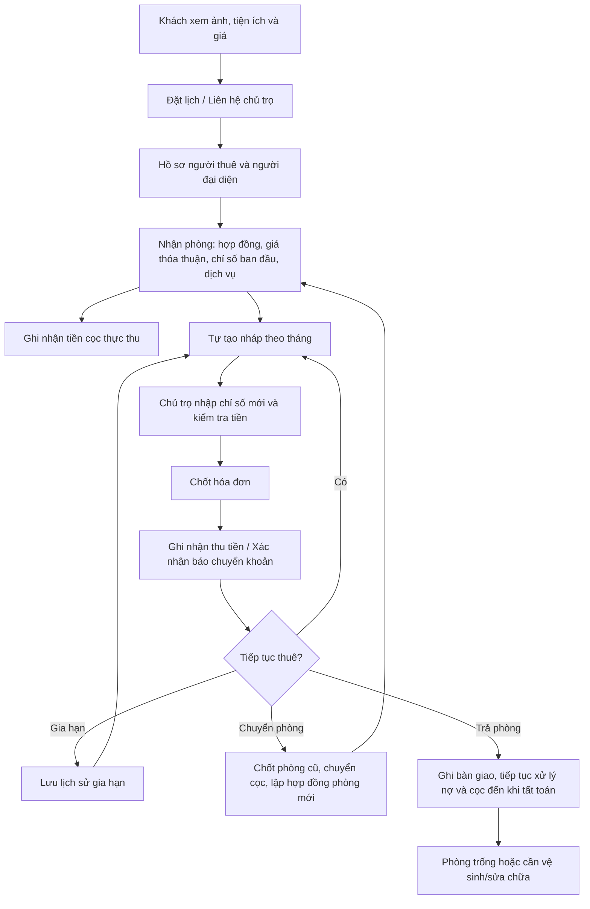
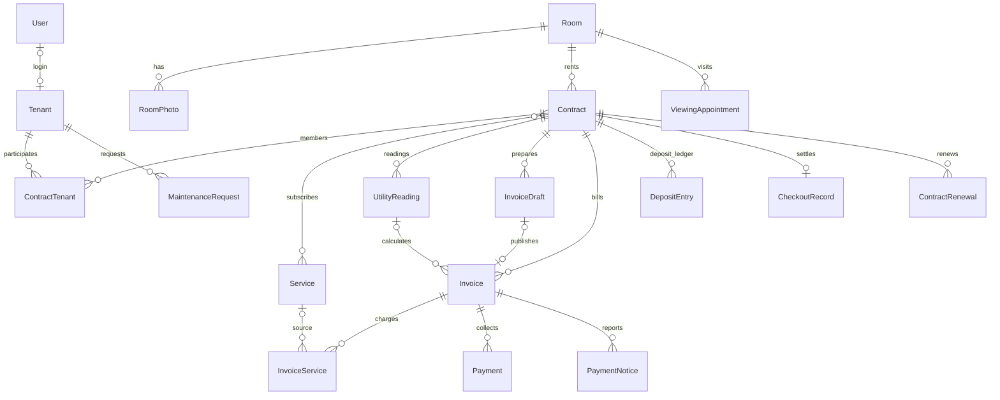

# Yêu cầu và thiết kế nghiệp vụ

## Tác nhân

| Tác nhân | Phạm vi |
|---|---|
| Khách vãng lai | Xem phòng trống, ảnh, tiện ích, giá thuê, điện nước, dịch vụ; đặt/tra cứu lịch xem phòng |
| Chủ trọ | Quản lý hồ sơ và vận hành nhà trọ, lập/chốt hóa đơn, đối chiếu tiền, quản lý cọc và báo cáo |
| Người đại diện hợp đồng | Xem phòng, hợp đồng, hóa đơn và lịch sử thanh toán của mình; báo chuyển khoản và yêu cầu sửa chữa |
| Người ở chung | Hồ sơ thành viên hợp đồng; chưa có tài khoản riêng |

## Quy tắc chính

1. Một phòng có tối đa một hợp đồng hiệu lực; một hợp đồng có tối đa một người được đánh dấu đại diện. Luồng lập hợp đồng yêu cầu đúng một đại diện.
2. Số người ở không vượt sức chứa; không được hạ sức chứa xuống dưới số đang ở.
3. Giá niêm yết phục vụ giới thiệu. Giá thuê thỏa thuận lưu trên hợp đồng và được dùng làm mặc định lập hóa đơn.
4. Hợp đồng mới chọn dịch vụ; hợp đồng cũ giữ cách áp dụng danh mục chung để không tự thay đổi dữ liệu vận hành đang có.
5. Tháng đầu nếu chọn chia theo ngày: `giá tháng × số ngày từ ngày nhận phòng đến hết tháng / số ngày trong tháng`, tính cả ngày nhận phòng; bỏ phần lẻ đồng.
6. Số điện/nước cũ lấy từ kỳ trước của hợp đồng hoặc số bàn giao ban đầu; số mới không nhỏ hơn số cũ.
7. Cùng phòng có thể có hai hợp đồng kế tiếp và hai chỉ số/hóa đơn riêng trong cùng tháng; không gộp người thuê cũ và mới.
8. Nháp chưa phát hành không có khoản thanh toán, không được tính công nợ và không hiển thị cho người thuê.
9. Một hợp đồng có một hóa đơn tháng; không tự áp dụng đơn giá mới vào hóa đơn/nháp đã chụp giá.
10. Khoản thu phải dương, nguyên đồng, không vượt nợ còn lại và không được mang ngày thu ở tương lai.
11. Cọc thỏa thuận khác cọc đã thu. Số dư thực giữ = thu + chuyển vào − hoàn − khấu trừ − chuyển ra.
12. Chuyển cọc không phải thu tiền lần nữa; cọc không cộng vào thực thu tiền thuê.
13. Có thể bàn giao khi còn nợ/nháp nếu xác nhận giữ lại trên hợp đồng cũ; vẫn được chốt nháp theo thời gian thuê thực tế. Khấu trừ tài sản cần lý do và không vượt cọc; đối trừ nợ hóa đơn ghi riêng. Hoàn cọc chỉ ghi sau khi đã thực trả. Có thể bàn giao phòng sang trạng thái cần vệ sinh/sửa chữa.
14. Không tự mở lại phòng khi hợp đồng hết thời hạn. Cần gia hạn hoặc làm thủ tục trả/chuyển phòng.

## Luồng chính

## Mô hình dữ liệu tóm tắt

`UtilityReading.contract` còn cho phép trống để giữ chỉ số lịch sử chưa gắn được hợp đồng một cách chắc chắn. Khi nâng cấp, chỉ số chỉ được gắn tự động nếu đang có đúng một hợp đồng sử dụng thông qua hóa đơn. Tất cả chỉ số mới phát sinh qua nghiệp vụ hóa đơn được gắn với hợp đồng.

## Đặc tả ngắn các use case cần trình bày

| Mã | Use case | Điều kiện và kết quả |
|---|---|---|
| UC01 | Xem thông tin phòng | Không cần đăng nhập; chỉ danh sách phòng trống, ảnh đúng phòng và giá đã cấu hình; không lộ hồ sơ khách thuê |
| UC02 | Đặt lịch xem | Phòng còn trống, ngày hợp lệ; trả mã hẹn, chưa tự giữ phòng hoặc tạo hợp đồng |
| UC03 | Nhận phòng | Chủ trọ, phòng sẵn sàng, đủ sức chứa, đại diện thuộc danh sách; lưu hợp đồng và thông tin bàn giao |
| UC04 | Thu cọc | Hợp đồng hiệu lực; thu thực tế từng lần, không vượt thỏa thuận và không ghi trùng cùng mã giao dịch |
| UC05 | Nhập điện nước | Có nháp; điền chỉ số điện cũ tự động, cho lưu dở số mới; nước mặc định 50.000đ/người/tháng, chủ trọ chốt số người và thu đủ tháng; lưu đơn giá, số người trên hóa đơn |
| UC06 | Chốt hóa đơn | Chọn phòng đủ thông tin; lưu giao dịch toàn bộ hoặc hoàn tác khi sai; phòng thiếu dữ liệu giữ nháp |
| UC07 | Thu tiền | Khoản thu hợp lệ, không vượt nợ; lưu nhiều lần và cập nhật trạng thái |
| UC08 | Xác nhận chuyển khoản | Thông báo chờ xử lý; chủ trọ đối chiếu; chỉ xác nhận một lần |
| UC09 | Chuyển phòng | Phòng đích sẵn sàng; xác nhận các khoản chưa tất toán; nợ/nháp giữ ở hợp đồng cũ, chỉ phần cọc dư được chuyển |
| UC10 | Trả phòng | Ghi bàn giao và khoản chưa tất toán; khấu trừ tài sản có lý do; hoàn tiền thực tế qua giao dịch riêng; nợ cũ tiếp tục theo dõi |
| UC11 | Báo cáo | Chủ trọ; thực thu theo ngày thu, công nợ theo hóa đơn, cọc tách riêng; xuất CSV |
| UC12 | Cổng người thuê | Chỉ hợp đồng/hóa đơn liên quan tài khoản đó; không truy cập được nghiệp vụ chủ trọ |

## Phi chức năng và kiểm chứng

- Phân quyền phía máy chủ; POST có CSRF; kiểm tra tệp ảnh và giới hạn dung lượng/số lượng.
- Các thao tác tài chính và chuyển phòng dùng giao dịch cơ sở dữ liệu; ràng buộc duy nhất bảo vệ phòng, người đại diện và kỳ hóa đơn.
- Bảng chỉ số có phiên bản và dấu mốc dữ liệu để từ chối ghi đè từ cửa sổ cũ.
- Đầu ra người dùng được escape trên HTML; CSV phòng tránh ô công thức từ dữ liệu nhập.
- SQLite dùng cho môi trường phát triển đã kiểm tra; cấu hình PostgreSQL có sẵn nhưng cần nghiệm thu kết nối và chuyển dữ liệu riêng.
- Ảnh thật và dữ liệu cơ sở dữ liệu phải được sao lưu cùng nhau.
- Giao diện dùng bố cục responsive; cần nghiệm thu trên thiết bị thật theo checklist, không tự tuyên bố đã kiểm thử trình duyệt nếu chưa chạy.
